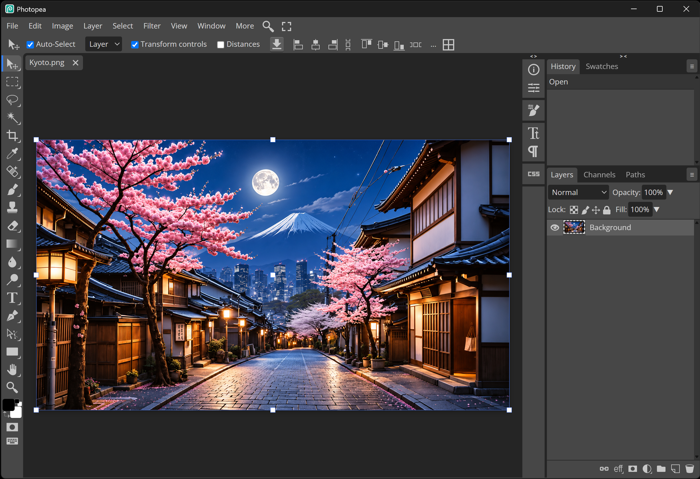

# Photopea Offline

A self-contained, fully offline build of [Photopea](https://www.photopea.com) for Windows, macOS and Linux, packaged as a single program.



- **No internet access.** Accounts, cloud storage, AI tools, ads and analytics are removed. The program serves Photopea from inside itself, and its window can't load anything else.
- **Uses your computer's fonts:** the Text tool lists every font installed on the computer.
- **Everything else included:** every file format, filter and tool.
- **Behaves like the website:**
  - open files by dragging them in
  - pinch to zoom
  - print
  - shortcuts
- **History length** is raised to 50 steps.

**Platform status:**
- **Windows:** built and tested.
- **macOS and Linux:** the code and build scripts are written for them, but they haven't been built or run on those systems yet. Expect to be the first to try.

## Repository layout

```
.
├── build-windows.ps1   Builds the program on Windows
├── build-macos.sh      Builds the program on macOS (as Photopea.app)
├── build-linux.sh      Builds the program on Linux
├── src-tauri/          The desktop program (Rust, Tauri 2)
│   ├── src/main.rs     Local server, offline lock, window
│   ├── build.rs        Embeds www/ into the program at build time
│   ├── icons/          App icons
│   └── target/         Build output (not part of the source)
├── www/                Photopea itself (offline version), built into the program
├── scripts/
│   └── test-app.mjs    Automatic test of the built program (Windows)
├── node_modules/       playwright-core, used by the test
└── package.json
```

Building needs only `src-tauri/`, `www/` and the build script for your system. The rest is for testing.

**Fonts:** the Text tool uses the fonts installed on the computer it runs on. At startup the program reads the font folders and gives Photopea the list:
- **Windows:** `C:\Windows\Fonts`, plus fonts installed for your user only
- **macOS:** `/System/Library/Fonts`, `/Library/Fonts` and `~/Library/Fonts`
- **Linux:** `/usr/share/fonts`, `/usr/local/share/fonts`, `~/.local/share/fonts` and `~/.fonts`

Details:
- **Fonts you install later** appear the next time the program starts.
- **Default font:** Arial, or Helvetica, DejaVu Sans, Liberation Sans or Noto Sans, whichever is installed first in that order.
- **Missing fonts:** when a document uses a font that isn't installed, Photopea shows a short "Font ➡ substitute" message and uses a similar installed font.
- **Font menu:** lists fonts by name, without the preview pictures Photopea's own font library had.
- **Interface font:** Photopea's menus and panels use Open Sans, which comes with the program (`www/gfonts`).

Each build script runs the same five steps, printing each as it goes:
1. check the tools
2. check the project files
3. check that Photopea isn't running
4. compile
5. say where the program was saved

You need about **12 GB** of free disk space on Windows (the C++ build tools are large), about **6 GB** on macOS and Linux. The tool installs and the **first** build need internet; later builds don't.

---

## Building on Windows

### 1. Install the tools (once)

#### a. Windows

Windows 10 or 11, 64-bit.

#### b. WebView2 Runtime

This is the browser engine the program uses.

- **Windows 11:** already installed. Skip this step.
- **Windows 10:** open **Settings → Apps → Installed apps** and look for **Microsoft Edge WebView2 Runtime**. If it's missing:
  1. Go to <https://developer.microsoft.com/microsoft-edge/webview2/>.
  2. Under **Evergreen Bootstrapper**, click **Download**.
  3. Run the downloaded file.

#### c. Microsoft C++ Build Tools

1. Go to <https://visualstudio.microsoft.com/visual-cpp-build-tools/> and click **Download Build Tools**.
2. Run `vs_BuildTools.exe`.
3. On the **Workloads** tab, tick **Desktop development with C++**. Leave the default parts it selects: "MSVC … C++ x64/x86 build tools" and a "Windows 11 SDK" (or Windows 10 SDK).
4. Click **Install** (about 6–7 GB).
5. Restart if asked.

#### d. Rust

1. Download **rustup-init.exe** (64-bit) from <https://rustup.rs> and run it.
   - If it says the Visual Studio C++ build tools are missing, go back to step c.
2. When it asks, type **1** and press Enter (*Proceed with standard installation*).
3. When it finishes, **close the window**.
4. Open a **new** PowerShell window (Start menu → type `PowerShell` → Enter) and check:
   ```powershell
   rustc --version
   cargo --version
   ```
   Both should print a version number. This project was built with Rust **1.95.0**; that version or any newer one works.

### 2. Copy the project

Copy this whole folder to a place where it will stay, for example `C:\Photopea`.

You can leave out `src-tauri\target\` (build output).

### 3. Build

```powershell
cd C:\Photopea
.\build-windows.ps1             # first build (needs internet, 5-15 minutes)
.\build-windows.ps1 -Offline    # later builds (1-3 minutes)
```

You can also right-click `build-windows.ps1` → **Run with PowerShell**; the window then stays open at the end.

If Windows says *running scripts is disabled on this system*, run it like this instead:
```powershell
powershell -ExecutionPolicy Bypass -File .\build-windows.ps1
```

**Result:** `C:\Photopea\src-tauri\target\release\photopea-offline.exe` (about 29 MB).

To build by hand instead, the script runs `cargo build --release --locked` (plus `--offline` with `-Offline`) in `src-tauri`. `--locked` makes it use exactly the package versions in `Cargo.lock`, the ones this project was tested with.

### Troubleshooting (Windows)

| Message | Fix |
|---|---|
| `linker 'link.exe' not found` | The C++ Build Tools are missing or incomplete: redo step 1c with **Desktop development with C++** ticked |
| `failed to download …` / `failed to get … as a dependency` | No internet during the first build. Connect and run again |
| `failed to remove file …photopea-offline.exe` / `Access is denied` | The program is running. Close it and build again |
| `cargo` / `rustc` is not recognized | Open a **new** PowerShell window after installing Rust, or redo step 1d |
| `the lock file … needs to be updated but --locked was passed` | `Cargo.lock` was changed or lost. Copy it again from the original folder |

### Building on a Windows computer with no internet at all

This route is untested. The normal route above is the one this project was built with.

1. **On a computer with internet**, prepare everything:
   - Download the Rust **standalone installer**: from <https://forge.rust-lang.org/infra/other-installation-methods.html#standalone-installers>, the `x86_64-pc-windows-msvc` `.msi`.
   - Make an **offline copy of the Build Tools**. In a folder with `vs_BuildTools.exe`, run:
     ```powershell
     .\vs_BuildTools.exe --layout C:\BuildToolsOffline --add Microsoft.VisualStudio.Workload.VCTools --includeRecommended --lang en-US
     ```
   - Download the **WebView2 Standalone Installer (x64)** from the WebView2 page (Windows 10 only).
   - Download all Rust packages into the project. With Rust installed on this computer:
     ```powershell
     cd C:\Photopea\src-tauri
     cargo vendor vendor
     ```
     Then create `src-tauri\.cargo\config.toml` with the lines `cargo vendor` prints:
     ```toml
     [source.crates-io]
     replace-with = "vendored-sources"

     [source.vendored-sources]
     directory = "vendor"
     ```
2. **Copy** the folder (now with `src-tauri\vendor` and `src-tauri\.cargo`) and the three installers to the offline computer.
3. **Install** WebView2 (Windows 10), the Build Tools from `C:\BuildToolsOffline\vs_BuildTools.exe` (tick **Desktop development with C++**), and Rust from the `.msi`.
4. **Build:** `.\build-windows.ps1 -Offline`

---

## Building on macOS

### 1. Install the tools (once)

#### a. macOS

macOS 10.15 (Catalina) or newer, on an Intel or Apple Silicon Mac.

#### b. Xcode Command Line Tools

Open **Terminal** (Applications → Utilities → Terminal) and run:
```bash
xcode-select --install
```
A window opens. Click **Install** and wait. If it says the tools are already installed, continue.

#### c. Rust

In Terminal, run:
```bash
curl --proto '=https' --tlsv1.2 -sSf https://sh.rustup.rs | sh
```
1. When it asks, type **1** and press Return (*Proceed with standard installation*).
2. When it finishes, close Terminal and open a **new** Terminal window.
3. Check:
   ```bash
   rustc --version
   cargo --version
   ```

The WebKit engine the program uses is part of macOS, so there's nothing else to install.

### 2. Copy the project

Copy this whole folder to a place where it will stay, for example your home folder as `Photopea` (`~/Photopea`). You can leave out `src-tauri/target/`.

### 3. Build

```bash
cd ~/Photopea
chmod +x build-macos.sh        # once, makes the script runnable
./build-macos.sh               # first build (needs internet, 5-15 minutes)
./build-macos.sh --offline     # later builds (1-3 minutes)
```

**Result:** `~/Photopea/src-tauri/target/release/Photopea.app`. Double-click it, or drag it into Applications.

To build by hand instead, the script runs `cargo build --release --locked` in `src-tauri`, then wraps the program `target/release/photopea-offline` in `Photopea.app`, adding an `Info.plist` and the icon.

### Troubleshooting (macOS)

| Message | Fix |
|---|---|
| `xcrun: error: invalid active developer path` or `linker 'cc' not found` | Install the Command Line Tools: `xcode-select --install` |
| `cargo: command not found` | Open a **new** Terminal window after installing Rust, or run `source "$HOME/.cargo/env"` |
| `Permission denied` when starting the script | Run `chmod +x build-macos.sh` once, or start it with `bash build-macos.sh` |
| "Photopea can't be opened because it is from an unidentified developer" | Only happens if the app was copied from another Mac. Right-click the app → **Open** → **Open** |
| `failed to download …` | No internet during the first build. Connect and run again |

---

## Building on Linux

### 1. Install the system packages (once)

The program uses WebKitGTK 4.1, so it needs a reasonably recent distribution: Ubuntu 22.04+, Debian 12+, Fedora 38+ or Arch. Install the build tools and libraries with the command for your distribution. These are the packages the Tauri framework documents for Linux.

**Ubuntu / Debian / Linux Mint / Pop!_OS:**
```bash
sudo apt update
sudo apt install libwebkit2gtk-4.1-dev build-essential curl wget file libxdo-dev libssl-dev libayatana-appindicator3-dev librsvg2-dev
```

**Fedora:**
```bash
sudo dnf check-update
sudo dnf install webkit2gtk4.1-devel openssl-devel curl wget file libappindicator-gtk3-devel librsvg2-devel libxdo-devel
sudo dnf group install "c-development"
```

**Arch / Manjaro:**
```bash
sudo pacman -Syu
sudo pacman -S --needed webkit2gtk-4.1 base-devel curl wget file openssl appmenu-gtk-module libappindicator-gtk3 librsvg xdotool
```

### 2. Rust

```bash
curl --proto '=https' --tlsv1.2 -sSf https://sh.rustup.rs | sh
```
1. When it asks, type **1** and press Enter (*Proceed with standard installation*).
2. When it finishes, open a **new** terminal.
3. Check:
   ```bash
   rustc --version
   cargo --version
   ```

### 3. Copy the project

Copy this whole folder to a place where it will stay, for example `~/Photopea`. You can leave out `src-tauri/target/`.

### 4. Build

```bash
cd ~/Photopea
chmod +x build-linux.sh        # once, makes the script runnable
./build-linux.sh               # first build (needs internet, 5-15 minutes)
./build-linux.sh --offline     # later builds (1-3 minutes)
```

**Result:** `~/Photopea/src-tauri/target/release/photopea-offline`. Start it from a terminal, or add it to your applications menu (see [Running](#running)).

To build by hand instead, the script runs `cargo build --release --locked` in `src-tauri`.

### Troubleshooting (Linux)

| Message | Fix |
|---|---|
| The script stops at "the library 'webkit2gtk-4.1' was not found", or cargo says `The system library 'webkit2gtk-4.1' required by crate … was not found` | Install the packages from step 1. On older distributions without WebKitGTK 4.1, the program can't be built |
| `linker 'cc' not found` | Install the packages from step 1 (they include the C compiler) |
| `cargo: command not found` | Open a **new** terminal after installing Rust, or run `source "$HOME/.cargo/env"` |
| `Permission denied` when starting the script | Run `chmod +x build-linux.sh` once, or start it with `bash build-linux.sh` |
| `failed to download …` | No internet during the first build. Connect and run again |

---

## Running

**Starting it:**
- **Windows:** double-click `photopea-offline.exe`. To make a shortcut: right-click it → **Show more options → Send to → Desktop (create shortcut)**.
- **macOS:** double-click `Photopea.app`, or drag it into Applications first.
- **Linux:** run `~/Photopea/src-tauri/target/release/photopea-offline`. To get it in your applications menu, create `~/.local/share/applications/photopea.desktop` with your own paths:
  ```ini
  [Desktop Entry]
  Type=Application
  Name=Photopea
  Exec=/home/YOU/Photopea/src-tauri/target/release/photopea-offline
  Icon=/home/YOU/Photopea/src-tauri/icons/128x128.png
  Categories=Graphics;
  ```

**Saving:**
- **Windows:** **File → Save as PSD** asks where to save. Exports (PNG, JPG, …) go to your **Downloads** folder, with a small downloads popup.
- **macOS / Linux:** saves and exports go to your **Downloads** folder.

**Port 8887:** the program runs a small local server on `127.0.0.1:8887`, the only port Photopea works on. Don't run other programs that use that port at the same time.

**Settings** are kept per user. On Windows they're in `%LOCALAPPDATA%\local.photopea.offline`; deleting that folder resets the program.

### Moving the program

The program is a single file (`Photopea.app` on macOS) with everything built in. You can move it anywhere, or copy it to another computer with the same operating system, and it uses that computer's fonts.


---

## Testing (Windows)

Requires [Node.js](https://nodejs.org) (LTS). It isn't needed to build the program. The test's one package, `playwright-core`, is included in `node_modules/`; on a computer with internet, `npm install` restores it if that folder is missing.

```
npm test
```

It starts the built exe off-screen with a fresh profile and checks:
- drawing, and History keeping 50 steps
- zoom (Ctrl+wheel and pinch)
- drag-drop
- printing
- downloads
- shortcuts
- that no request leaves the computer

It prints one `ok` / `FAIL` line per check and `PASS` at the end.

Close the program before running it. Expect the downloads popup once: one check downloads a 3-byte test file into `src-tauri\target\test-dl`.
